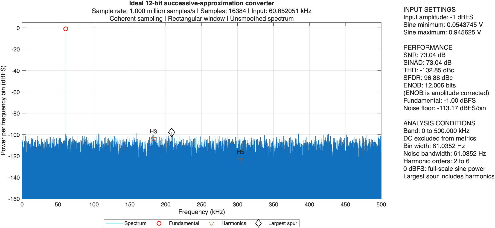

# Analog-to-Digital Converter Design Project

This project separates converter modeling, circuit implementation, measurement data, and reference material. The current model is an ideal successive-approximation analog-to-digital converter, with a coherent sine-wave performance test.

The device model samples charge on a single-ended, binary-weighted capacitor array, switches its bottom plates during successive decisions, and then proceeds to the next sample. Floating-node voltage follows charge conservation. Ideal matching, switching, references, and comparator decisions are assumed. An explicit comparator-reference bias preserves the selected half-LSB transfer convention. Acquisition and decision times describe the sequence; circuit nonidealities are not included.

## Run the simulation

Open [main.m](modeling/matlab/main.m) in MATLAB, edit the parameters at the top, and click the green **Run** button to execute the entire file. If MATLAB requests a path change, choose **Change Folder**. The script displays the frequency spectrum and performance metrics and saves a new result directory.

## Verified ideal baseline

The initial repository baseline is implementation **3.0.2**, verified with MATLAB R2026a Update 4. It requires MATLAB only; no additional toolbox is used. Default settings are 12 bits, 1 MS/s, a 0-1 V input range, 16384 samples, 997 coherent cycles, and a -1 dBFS sine. The recorded SNR is 73.043654 dB, SINAD is 73.039112 dB, and amplitude-corrected ENOB is 12.006499 bits.



The [selected baseline run](modeling/matlab/results/coherent_sine_wave/run_20261026_000733_tpbee5f8eb_f899_48ab_9fab_569a104d4ee2/) includes its configuration, numeric results, plots, and original source snapshot. Other generated runs remain local and are ignored by Git. Historical verification links may therefore refer to local records outside this repository. New runs are saved locally when main.m is executed; see [result formats and replay instructions](modeling/matlab/results/README.md).

Reference PDFs are supplied separately and are not included in this repository. They are not required to execute the model. The [reference index](references/README.md) and [reference alignment](documentation/ANALOG_DEVICES_REFERENCE_ALIGNMENT.md) document their role.

## Project structure

```text
ADC OCT 2026 version/
|-- README.md
|-- AGENTS.md                              Instructions for future assistance
|-- documentation/                         Shared project decisions and reference alignment
|-- references/analog_devices/             Supplied testing manual
|-- modeling/matlab/
|   |-- main.m                             Set parameters and run the simulation
|   |-- +converterModel/                   Converter circuit model
|   |-- testing/
|   |   |-- runCoherentSineWaveTest.m       Execute the converter performance test
|   |   |-- +parameters/                   Create and validate configuration
|   |   |-- +inputSignals/                 Generate the test input
|   |   |-- +spectrumAnalysis/             Calculate the spectrum and metrics
|   |   `-- +reporting/                    Display and save results
|   |-- documentation/                     Model definitions, working notes, and verification
|   `-- results/                           One directory per saved run
|-- design/                                Future circuit and layout implementation
`-- measurements/                          Future chip and board measurements
```

A leading `+` is MATLAB's package-folder marker. It gives the functions a group name: a file in `+converterModel` is called as `converterModel.functionName(...)`. Ordinary folders organize files; package folders also define how MATLAB resolves function calls.

`testing` means testing converter performance with an input signal and output analysis. Configuration validation checks whether supplied parameters are supported. These are separate responsibilities; there is no additional self-test script to run before main.

## Reading order

1. [MATLAB usage](modeling/matlab/README.md): run the model and change parameters.
2. [Code structure](modeling/matlab/documentation/CODE_STRUCTURE.md): follow the calls from main into the test and model functions.
3. [Model definitions](modeling/matlab/documentation/MODEL_DEFINITIONS.md): check the implemented mathematics and metric definitions.
4. [Verified simulation results](modeling/matlab/documentation/VERIFIED_SIMULATION_RESULTS.md): inspect executed evidence.
5. [Project structure and naming](documentation/PROJECT_STRUCTURE.md): find files and resolve old names.

Working notes: [Device Modeling Notes](modeling/matlab/documentation/DEVICE_MODELING_NOTES.md) and [Converter Testing Notes](modeling/matlab/documentation/CONVERTER_TESTING_NOTES.md). The device note is reserved for later discussion; the testing note contains the existing sampling-parameter rationale.

The supplied Analog Devices manual is the controlling methodological reference where applicable; see [reference alignment](documentation/ANALOG_DEVICES_REFERENCE_ALIGNMENT.md). The implementation covers the ideal model and coherent single-tone analysis, not every test in the manual. No nonidealities have been added.

All project-authored documentation, comments, labels, and messages use English.
